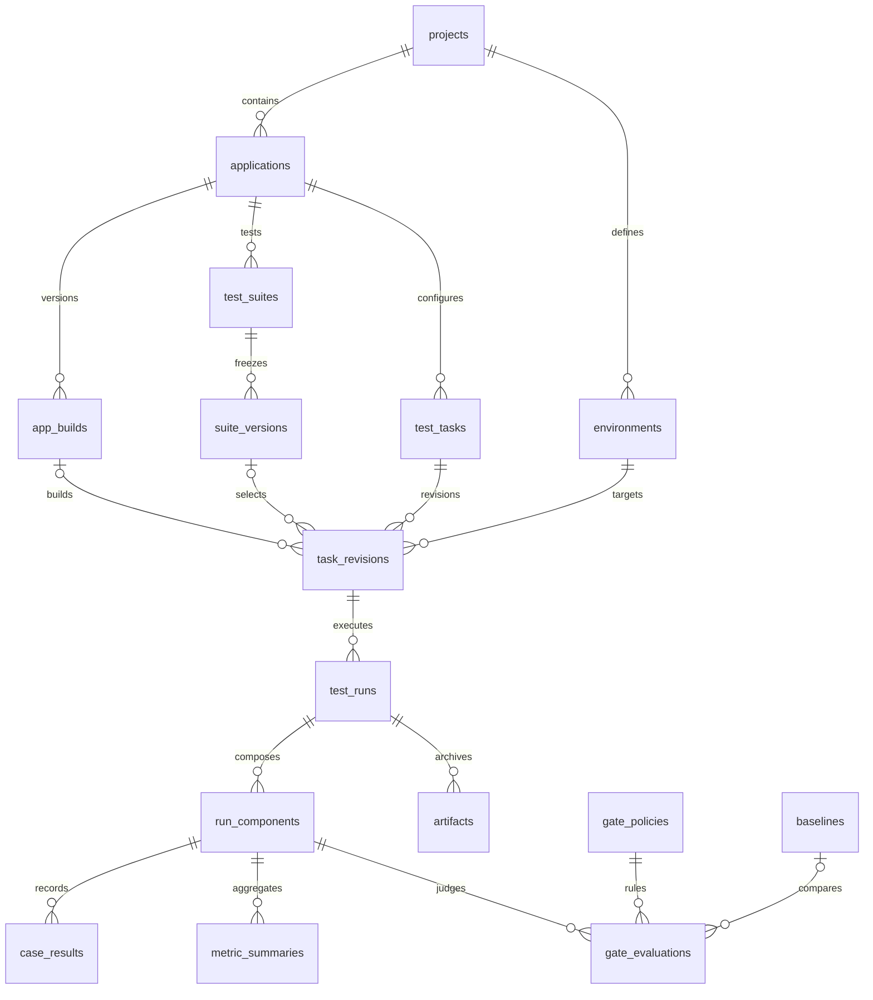

# TestDock 多端平台数据库设计（草案 v1）

设计日期：2026-10-25。范围：为现有交互原型补充持久化模型；覆盖 Android、iOS、Web，共用 UI 自动化与性能测试。**本次没有连接、安装、初始化或迁移数据库，也没有接入真实执行器。**

交付：`schema.sql` 为 PostgreSQL 建表草案；`index.html#database` 为可交互的数据关系与字段字典。SQL 的列、键、索引为物理设计；本文注明哪些规则仍须由后端实施。原型当前仍使用 localStorage，不会因增加此页面自动具备数据库能力。

## 1. 选型与部署边界

建议首期采用 **一个 PostgreSQL 业务库 + 私有文件存储**。单机阶段文件可放受控目录；需要多节点共享后再接对象存储。此为拟定方案，不锁定用户已有基础设施，不新增安装依赖。

- 关系库保存项目、应用、版本、运行状态、证据元数据及性能摘要。需要事务维护跨实体关联，提交幂等、租约唯一性也落在数据库约束上。
- 文件存储保存 APK/IPA、截图、UI 树、录像、trace、完整日志、原始 series 和不可变报告。数据库保存 storage_key、SHA-256、大小、类型、可用性，不保存视频 BLOB 或临时签名 URL。
- JSONB 仅容纳不同端的配置、能力清单、规则、脱敏快照；项目、应用、状态、资源关系和查询维度使用显式列。JSON 必须有应用层 schemaVersion 和大小上限。
- 首期用数据库运行队列，不先引入 Redis、消息队列、时序数据库。性能数据量实测后再决定冷热分离或专用时序存储。
- 多人使用按 project_id 授权，首期节点与资源按项目独占。身份来自外部身份提供方，业务库只存 issuer + subject，不存密码或访问令牌。
- SQL 按 PostgreSQL 17 官方语法文档设计；正式落地需确认组织标准版本并在目标版本执行迁移测试。不是“已验证可在任何数据库直接执行”的通用 SQL。

参考依据：PostgreSQL 的[关系约束](https://www.postgresql.org/docs/17/ddl-constraints.html)、[部分索引](https://www.postgresql.org/docs/17/indexes-partial.html)、[JSON 类型](https://www.postgresql.org/docs/17/datatype-json.html)和[队列选取锁定语法](https://www.postgresql.org/docs/17/sql-select.html)，均于 2026-10-25 查阅。后续设计选择为本项目判断，不代表官方推荐此完整架构。

## 2. 领域关系

资源链路独立：execution_nodes → execution_resources → resource_leases。resource_profiles 为不可变档案，实例当前档案可以升级，而 test_runs.profile_id 始终保留实际运行时档案。租约的持有者必须且只能是一个 test_run 或 debug_session。UI + 性能联动是一条运行、同一资源租约、两个 run_component，不能各拿一把互相竞争的锁。

表名没有 android_runs、ios_runs、web_runs。应用决定目标端，test_type 决定测试能力，适配器决定执行方法。新增端需要更新受控平台取值与适配器配置 schema；并非无需任何迁移就支持任意端。

## 3. 表清单与职责

以下共 24 张表。完整列类型、空值约束、唯一约束、外键和中文字段说明见 `schema.sql`；原型字段字典可逐表查看。

| 表 | 业务名称 | 职责 |
| --- | --- | --- |
| `projects` | 项目 | 产品级隔离单元，Android、iOS、Web 应用归属于同一项目。 |
| `project_members` | 项目成员 | 复用身份提供方，以项目角色授权，不在业务库保存登录口令。 |
| `applications` | 应用 | 目标端属于应用，不为每种端复制一套任务和报告表。 |
| `app_builds` | 应用构建 | 固定待测构建；移动包与 Web 部署均采用同一版本记录。 |
| `environments` | 测试环境 | 保存各环境的非敏感配置，实际站点地址可随环境区分。 |
| `execution_nodes` | 执行节点 | 宿主 Agent 与可用适配器，初期按项目独占。 |
| `resource_profiles` | 资源档案 | 不可变的可比性档案：系统、设备或浏览器、采集器、分辨率、指标版本。 |
| `execution_resources` | 执行实例 | 真机、模拟器或浏览器槽位。每个实例只承载一个活动运行。 |
| `test_suites` | 测试套件 | 登记代码维护的 UI 用例或性能场景，不把脚本正文塞进数据库。 |
| `suite_versions` | 套件版本 | 固定仓库、提交及选择器，旧运行可追溯到当时的用例。 |
| `test_tasks` | 测试任务 | 用户可编辑的逻辑任务；不存通过或失败结果。 |
| `task_revisions` | 任务配置版本 | 每次保存新增不可变修订；运行只引用已验证修订。 |
| `test_runs` | 测试运行 | 一次提交或重跑对应一行，保留执行状态、最终结论和当时配置。 |
| `debug_sessions` | 调试会话 | 人工设备控制使用短期调试会话，与自动运行竞争同一资源租约。 |
| `resource_leases` | 资源租约 | 保留运行或调试的独占历史，用 fencing token 拒绝过期执行者。 |
| `run_components` | 运行组件 | 一次运行下的 UI/性能子结果。联动共用运行和租约，分别保留结论。 |
| `case_results` | 用例结果 | 每个用例的执行尝试独立保存，可区分用例重试与整次重跑。 |
| `artifacts` | 证据文件 | 保存文件元数据和私有存储键，截图、日志、录像、曲线均通过此表归档。 |
| `metric_summaries` | 性能摘要 | 按指标、统计窗口和统计量保存查询所需的小体积摘要。 |
| `baselines` | 基线版本 | 不可变的对照版本；源运行和全部可比性信息一并保留。 |
| `gate_policies` | 门禁规则版本 | 平台持有门槛，适配器负责正确的测量与统计。 |
| `gate_evaluations` | 门禁判定 | 原始判定与后续试算分开保存；改规则不会覆盖历史结论。 |
| `run_events` | 运行事件 | 状态变化、步骤标记、接入事件按运行顺序追加，支持断线续看。 |
| `audit_events` | 审计事件 | 记录谁修改配置、发起运行或调整规则，不承载完整业务数据。 |

刻意不增加独立 reports 主表：报告是 test_runs + run_components + 结果明细的查询视图；归档报告文件记入 artifacts，logical_key 使用带版本的键（例如 report/original/v1.json）。以后若要签核、发布或分享报告，再增加对应业务实体，不能把任务状态和报告状态重复维护。

图像模板仍由现有 UI 组件管理不可变版本；suite_versions.manifest / task_revisions.config 只引用模板逻辑名、版本及校验摘要。平台自建跨宿主模板库属于后续范围，不能把宿主本地路径当成跨机器可用 URL。

## 4. 任务、版本与执行语义

| 层次 | 状态 / 值 | 含义 |
| --- | --- | --- |
| test_tasks.lifecycle | draft / ready / archived | 逻辑配置状态；不存执行通过率 |
| task_revisions.readiness | draft / validated | 配置修订是否通过提交前校验 |
| test_runs.state | queued / dispatching / running / finalizing / completed / errored / cancelled | 执行生命周期 |
| test_runs.outcome | passed / failed / not_tested / NULL | completed 才有测试结论；其他状态必须 NULL |
| gate_evaluations.mode | original / reanalysis | 原始判定和后续规则试算 |
| artifacts.availability | available / missing / expired | 证据可用性，不改历史测试结果 |

- 保存草稿：新建或更新 test_tasks 的展示信息，递增 lock_version；追加 task_revisions。UI、Web、iOS 使用同样路径。列表取最新 revision，历史版本不覆盖。
- 验证配置时另存 validated 修订，不原地改写已有草稿修订；同步更新逻辑任务的 ready 状态。提交：事务中验证成员权限、任务未归档、revision 已 validated、套件类型匹配、应用构建明确、环境配置完整以及适配器确实支持。将脱敏配置和规则引用固化后新增 queued 运行。**Web/iOS 当前没有执行适配器，因此仍只保存 draft，禁止创建虚假运行。**
- 排队 → dispatching：调度器用短事务领取，绑定实例与档案，并创建带 token 的租约。dispatching 也受超时与 Agent 确认协议控制。
- running → finalizing：采集结束但证据还在校验归档。完整性策略满足后才 completed；测试断言不满足属于 completed + failed，节点断连等基础设施故障属于 errored + NULL。
- 缺指标、有效样本不足、基线不可比属于 completed + not_tested，并保留原因；不能混作“未运行草稿”。cancelled 也不计入通过率。
- 重跑：新建 test_runs，parent_run_id 指向原记录；默认复用原 revision。用户显式选择新配置版本时允许新 revision，但保留父运行关系。两个运行均不覆盖。
- 用例重试：同一 run_component 下按 case_key + attempt 追加。套件汇总应规定取最终尝试，同时保留前序失败，避免重试把用例数量膨胀。
- 原始结论不可变。修改阈值先新增 gate_policies 版本，再新增 reanalysis 判定；原始运行 outcome 和 original 判定均保持不变。
- 终态不可回退、版本快照不可改、合法状态转换、更新时间维护，由后端事务和受限写权限保证；DDL 中的 CHECK 只约束行值，不是完整状态机。

运行通过率：passed / (passed + failed)，不含 not_tested、errored、cancelled、草稿；同时独立展示未判定率与执行错误数。联动时原始汇总建议：执行基础设施错误 → errored；正常完成后任一阻断失败 → failed；无失败但有必需组件 not_tested → not_tested；否则 passed。warn 只展示告警，不自动变成 failed。具体组件必需性在配置快照中固定。

## 5. 跨端配置与性能口径

公共配置包含 schemaVersion、adapter.key/version、固定 suite_version/build、environment、resourceRequirements、超时及证据策略。Android 包名与 iOS Bundle ID 属于 applications.identifier；Web 的 identifier 是稳定逻辑站点标识，实际 base URL 固定在环境快照，不能把可变 URL 当构建版本。

| 目标端 | config 中的端侧字段示例 | resource_profiles.spec 口径 |
| --- | --- | --- |
| Android | package、权限检查、采集窗口、原生或图像定位参数 | 设备型号、OS、分辨率、采集器与指标 schema、频率和测量范围 |
| iOS | bundleId、真机或模拟器需求、启动配置 | 型号、OS、执行及采集适配器版本、真机/模拟器差异 |
| Web | baseURL、browserEngine、viewport、locale | 内核及版本、操作系统、视口、节点规格、网络与采样条件 |

基线可比性至少校验：同项目、应用、环境、场景版本、profile fingerprint，以及 metric_key/version、unit、scope、window、statistic。首期保守使用精确场景版本；跨用例版本比较需要后续显式定义兼容规则。WebKit 配置不等于已提供 Safari/iOS 真机能力。

metric_summaries.value 缺失必须 NULL + missing_reason，绝不能填 0。统计窗口须有稳定 key 和明确定义；同名 CPU 指标可能是 app 级或整机级，必须用 scope 区分。原始曲线入 artifacts(metric_series)，按需读取或下采样，不全量加载到任务列表。

现有 Android 性能组件使用 median、显式阈值和有效样本下限；单位归一化需在适配器验证后写库，不擅自把既有 MB 改称 MiB。Web 或 iOS 未来可以有不同统计量，不能因为数据库有 p95 字段就声称当前组件已实现它。

## 6. 并发、幂等与资源租约

### 数据库实际覆盖的约束

- UUID 主键；核心父实体有 UNIQUE(project_id, id)，子表通过复合外键阻止跨项目关联。应用构建、套件版本、任务修订还带 application_id 复合约束，防止同项目内串应用。
- test_runs 的应用和资源均约束目标端；profile 单独引用不可变档案，避免实例升级系统后改写或阻塞历史运行。
- UNIQUE(project_id, request_key) 防止重复提交创建多次运行。相同键但不同参数必须返回冲突，不可悄悄返回另一份任务。
- 未释放租约对 resource_id、run_id、debug_session_id 分别使用部分唯一索引；租约要求 run/debug 仅有一个非空。
- 事件有生产者幂等键和运行内 sequence；每个性能组件最多一个 original 门禁判定；同运行证据 logical_key 唯一。
- 所有外键默认 NO ACTION，无级联删除。归档不会使历史关联失效。

### 服务层必须完成的协议

1. API 在事务内校验授权与任务修订；适配器能力来自已注册节点，不能只信任前端选择。
2. 调度器可用 `FOR UPDATE SKIP LOCKED` 领取 queued 行。短事务锁顺序统一为运行 → 资源 → 租约；人工调试先锁调试会话再锁资源。性能/UI 子组件共享父运行租约。
3. 分配时锁 execution_resources，校验 profile 与配置匹配、实例 ready 且不存在未释放租约，递增 fence_counter，再以同一个 token 新增 resource_leases。profile_id 与 config_snapshot 同时固定在运行上。
4. Agent 通过鉴权 API 获取任务，不直接访问业务库。宿主每次执行设备命令及上报状态时检查 token，拒绝旧 token；续租必须匹配 holder/token/未释放状态。
5. expires_at 到期只表示需要检查，不能立即释放并把设备交给下一任务。先停止或隔离旧执行者；无法确认时标记资源 offline/draining，等待恢复。人工控制与自动化运行遵循同样规则。
6. 租约释放、运行终态和运行事件尽量在同一业务事务落库。迟到回调以运行状态、token、幂等事件键校验，不得覆盖终态。
7. 配置更新用 `WHERE id = :id AND lock_version = :expected`，更新 0 行返回版本冲突；任务修订号在父任务行锁内分配。

不能仅凭数据库租约声称获得“恰好一次”真实执行。网络断开后的 Agent 行为和设备锁仍需宿主协议。当前 mobile_auto 使用本机文件租约，平台租约只是调度层；宿主还必须通过现有 DeviceSession / DeviceGate 准入。平台不能绕过本机锁直接发 ADB 命令。

## 7. 文件归档、索引与容量

文件流程：暂存上传 → 计算摘要/校验完整性 → 写入不可变对象键 → 事务提交 artifacts 及汇总 → 完成运行。上传成功而事务失败会留下孤儿文件，元数据成功而文件遗失会显示 missing；需要幂等重试、对账和经确认的保留策略。读取时重新验证项目权限，按需签发短期下载地址。

主要索引已经写入 schema.sql：

| 查询 / 冲突 | 索引策略 |
| --- | --- |
| 项目、应用、目标端的最近运行 | project_id + 筛选维度 + created_at DESC + id DESC |
| 待运行队列 | state = queued 的部分索引 |
| 资源分配与过期租约 | 资源状态索引、未释放租约唯一索引、到期索引 |
| 运行事件续读 | project_id + run_id + sequence 唯一索引 |
| 用例结果、指标、证据 | 各父关联作为唯一键前缀，避免重复写入 |
| 原始与试算判定 | 每组件单一 original，组件 + 时间查询 |
| 审计 | project_id + 时间 + id |

列表采用 created_at + id 游标分页；不先对全部 JSONB 建 GIN，也不承诺这些索引适配所有未来查询。正式数据量下测 EXPLAIN 后增加必要组合索引。

容量示例仅用于估算：若每天 100 次性能运行、每次 10 分钟、每秒 10 个指标，则每日 600,000 个样本值；这不是当前项目采样率事实。数据库只存每运行每窗口摘要；曲线文件压缩归档。截图/录像容量按真实样本测量，不在无数据时给固定硬盘结论。

保留期需要用户确定；建议把业务配置/版本、结果摘要、原始曲线、截图录像、审计分别配置，当前不执行清理。归档配置与到期证据可保留元数据。备份同时涵盖数据库和对象索引/文件，恢复演练必须验证引用与摘要；只恢复 SQL 不等于恢复失败现场。

## 8. 权限与数据边界

| 角色 | 建议权限 |
| --- | --- |
| viewer | 查看本项目任务、结果和经授权证据 |
| runner | viewer + 创建草稿、提交和取消本人运行 |
| maintainer | runner + 管理应用、环境、节点配置、规则与基线 |
| owner | maintainer + 管理项目成员及归档策略 |

DDL 不自动实现这些权限，也未配置 PostgreSQL RLS。所有读写必须在 API 验证成员身份并绑定 project_id；下载、WebSocket 和后台回调同样检查授权。外键保证数据完整性，不能代替访问隔离。需要用户级运行权限时可用 created_by/actor_ref 实施，绝不接受前端自报用户身份。

环境变量、日志、UI 树、请求 trace 可能包含敏感内容：持久化前按 schema 白名单和脱敏策略处理。配置只保存 secret_ref；secret_ref 不应是把凭据编码后存入的替代形式。身份引用/设备标识也限制可见范围。

## 9. 与现有组件及原型的映射

本轮重新读取性能项目 `src/mobile_perf/report.py`、`judge.py`，确认以下报文字段与判定语义；未运行真机测试。此前原型中的数值和设备仍是演示数据。

| 现有数据 / 界面 | 平台持久化 |
| --- | --- |
| 原型 tasks 数组的一行 | 正式后端拆成 test_tasks + task_revisions + test_runs；draft 没有 run |
| 原型 platform / device | applications.platform + execution_resources + resource_profiles |
| pytest 套件 / 场景 | test_suites + 固定代码提交的 suite_versions |
| UI 用例异常、截图、树 | case_results + artifacts；宿主原路径须受控上传 |
| 性能 runId / hostRunId | run_components.external_run_id / 平台 test_runs.id；同时保留原始报告 |
| schemaVersion / deviceProfile | 组件 summary 原值 + profile 快照；不能无校验转换 |
| metricsSummary | metric_summaries，保留单位、scope、统计量和样本数 |
| series / events / marks | 原始 artifacts + 必要的 run_events；不复制全部采样点到事件表 |
| integrity | run_components.summary 的完整性信息，finalizing 时校验 |
| JudgeSpec 与原始 Verdict | gate_policies 固定版本 + gate_evaluations(original) |
| 冻结拾取与人工控制 | debug_sessions + 同一资源租约准入；快照或模板仍有宿主不可变版本 |

现有组件可能已有本地性能存储，其表与平台表不直接共库重用。先做宿主适配器把已经归档的结果转换并导入；用外部 run ID、平台 run ID 和幂等键建立映射。不要直接迁移其内部表或覆盖原始文件。

落地分期：

1. 建库与 API 基础：项目/成员/应用/环境、任务版本、幂等运行提交；保持原型客户端与服务端模型分离。
2. Android 接入：Agent 能力注册、调度/租约/人工调试准入、证据归档、真实状态和报告；UI/性能各自先跑通。
3. 联动与质量：统一租约下编排两组件、规则/基线版本、原始判定与试算；失联和重复回调演练。
4. Web/iOS 适配：增加各端执行器和配置校验，不复制核心表。原型草稿经后端重新验证后才转为可运行。

## 10. 验收与待决事项

实现前需在隔离空库验证：

- DDL 创建成功；重复执行以迁移版本管理拦截，不使用 IF NOT EXISTS 掩盖 schema 漂移。
- 跨项目/跨应用外键拒绝错误关联，运行资源平台不匹配时拒绝写入。
- 并发同幂等键只产生一个运行；不同参数复用该键返回冲突。
- 同设备两次运行、运行与调试竞争时仅一条未释放租约成功；过期 token 无法续租或写回终态。
- 草稿无法提交；缺构建/套件的 validated 修订无法写入；无适配器不能运行。
- queued 不能存 passed，completed 不能缺 outcome，errored 不能伪装成测试失败。
- 用例重试、整次重跑、重复回调、断线重连均保留正确历史且不重复计数。
- 缺指标保存 NULL；跨档案基线得到 not_tested；改规则试算不改变 original。
- 当前实例档案变更不会影响旧运行的 profile 引用；活动租约期间禁止更换实例档案。
- 原始文件丢失、归档失败、Agent 失联时有可解释状态；数据库和文件备份联合恢复通过。
- 未授权用户无法跨项目查询、下载、调试或订阅事件。

待决：组织标准数据库版本、身份提供方、部署是否多节点、真实运行量和证据大小、保留期与恢复目标。均不阻碍本设计评审，但会影响正式部署和容量参数。

### 本轮验证与自查结论

2026-10-25，本轮新鲜验证：

- 执行 `node docs/platform-prototype/verify-design.cjs` 通过：24 张表、231 个字段、56 个外键；逐项比较 SQL 与原型字典定义，并检查外键列存在、类型对应及目标唯一键。JavaScript 语法检查通过。
- 内置浏览器经本机 HTTP 检查：数据设计入口、实体卡片跳转、字段名检索、搜索空态、领域筛选、父表关联跳转及四种流程切换均正常。
- 检查默认桌面布局和 390 × 844 窄屏；窄屏字典文档宽度与滚动宽度均为 375 CSS px，无文档级横向溢出；宽字段表在自己的容器中滚动。
- 回归原型任务编号搜索、Android 性能指标页、Web 规划页和新建草稿向导入口。浏览器本轮未记录控制台 error。
- 文档与 SQL 链接指向同目录实际文件；本轮不重复声称已验证浏览器下载最终落盘。文件协议访问的旧限制仍见 research.md。

自查重点：跨项目/跨应用外键、历史运行与当前设备档案解耦、调试与运行租约互斥、原始判定与试算分离、文件与数据库非原子提交。已在模型或服务约束中明确处理；不是独立上下文审查。

残余限制：当前环境未发现 PostgreSQL 命令工具，本轮未安装 PostgreSQL、未执行此 SQL。验证脚本不是 PostgreSQL 解析器，不能验证完整 CHECK 语义、索引性能或权限；真实建库、并发、Agent fencing、迁移与恢复测试仍须在正式接入阶段执行。
